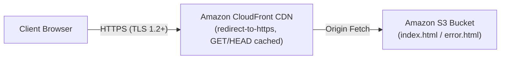

# AWS S3 + CloudFront Static Website Deployment with Terraform

Reproducible Infrastructure-as-Code (IaC) configuration that provisions an Amazon S3 static website fronted by an Amazon CloudFront global CDN distribution using Terraform.

## Architecture



### Provisioned Resources (main.tf)
- **aws_s3_bucket.s3bucket**: S3 bucket tagged (Name = StaticWebsite, Environment = Dev) storing index.html and error.html.
- **aws_s3_bucket_website_configuration.website_config**: Configures index.html as the root document and error.html for 4xx/5xx routing.
- **aws_s3_bucket_public_access_block.allow_public & aws_s3_bucket_policy.public_policy**: Grants read-only s3:GetObject access on ${aws_s3_bucket.s3bucket.arn}/*.
- **aws_cloudfront_distribution.cdn**: Global edge distribution enforcing 
edirect-to-https for viewers, caching GET/HEAD requests without forwarding cookies or query strings.

## How to Deploy

### Prerequisites
- [Terraform](https://developer.hashicorp.com/terraform/downloads) >= 1.0
- AWS CLI configured with least-privilege IAM credentials (aws configure)

### Steps
1. **Clone the repository**
   ```bash
   git clone https://github.com/BrailleNshuti/Secure-Static-Website-Deployment-on-AWS-using-Terraform.git
   cd Secure-Static-Website-Deployment-on-AWS-using-Terraform
   ```
2. **Initialize and validate**
   ```bash
   terraform init
   terraform fmt -check
   terraform validate
   ```
3. **Plan and apply**
   ```bash
   terraform plan -var="aws_region=eu-central-1" -var="s3_bucket_name=<unique-bucket-name>" -out=tfplan
   terraform apply tfplan
   ```
4. **Tear down when finished**
   ```bash
   terraform destroy -var="aws_region=eu-central-1" -var="s3_bucket_name=<unique-bucket-name>"
   ```

## Cost Breakdown (EU-Central-1 / US-East-1)

| Service | Pricing Dimension | Low-Traffic / Portfolio Estimate |
|---|---|---|
| **Amazon S3** | Storage ($0.023/GB/mo) + GET requests ($0.0004 / 1,000) | < .05 / month (< 10 MB assets) |
| **Amazon CloudFront** | First **1 TB/month** data transfer out + **10,000,000** HTTP/HTTPS requests | **$0.00 / month** (AWS Free Tier always-free allowance) |
| **Total** | Idle / portfolio traffic (< 10k visits/mo) | **< $0.10 / month** |

## Security Choices & Production Hardening

1. **Viewer HTTPS Enforcement**: CloudFront sets `viewer_protocol_policy = "redirect-to-https"`, ensuring clients never browse over unencrypted HTTP.
2. **Minimal Attack Surface**: Only GET and HEAD methods are allowed at the CDN edge; cookies and query strings are stripped (`forward = "none"`) to maximize cache hit ratio and prevent cache-key poisoning.
3. **No Hardcoded Credentials**: The AWS provider reads credentials strictly from the environment or shared AWS credentials profile, and .gitignore excludes .terraform/, *.tfstate, and *.tfvars.
4. **Public S3 Website Endpoint vs. CloudFront Origin Access Control (OAC)**:
   - *Current lab configuration (main.tf)*: Uses S3 static website hosting with a read-only s3:GetObject bucket policy so both the direct S3 website endpoint and CloudFront URL can be inspected side-by-side.
   - *Production hardening path*: Set all four aws_s3_bucket_public_access_block flags to 	rue, replace the custom HTTP origin with aws_cloudfront_origin_access_control (SigV4 signing), and restrict the S3 bucket policy principal strictly to cloudfront.amazonaws.com (AWS:SourceArn matching the distribution ARN) so users cannot bypass CloudFront.